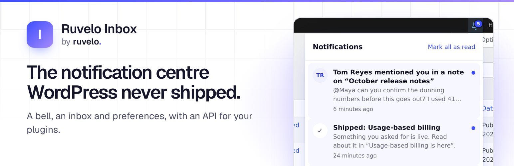
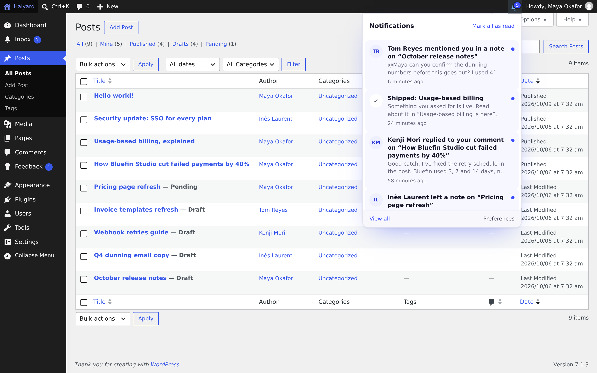
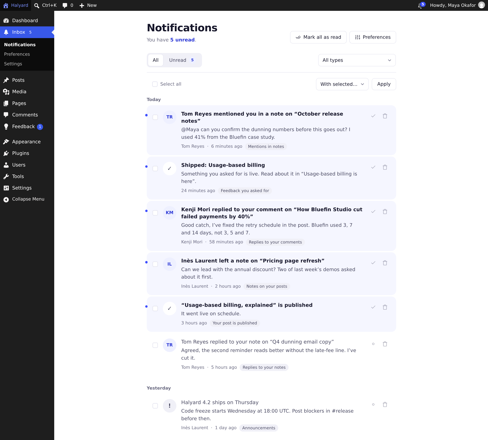
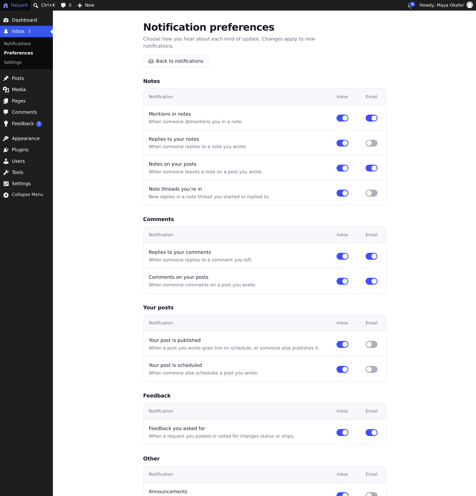
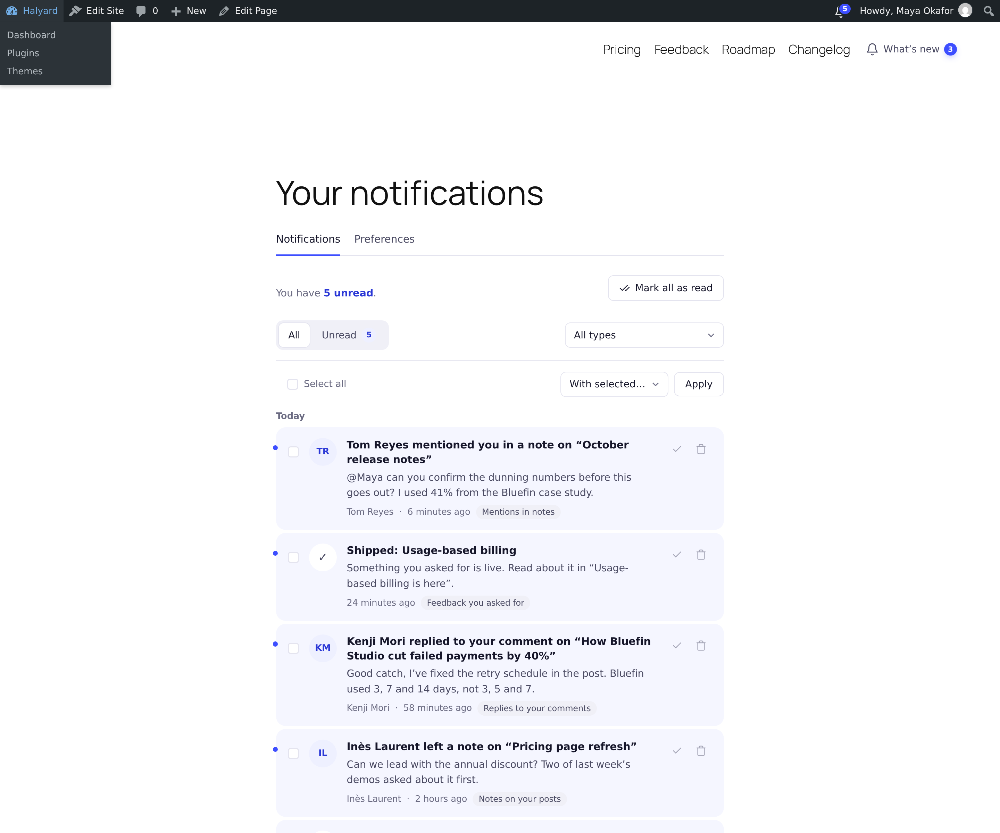
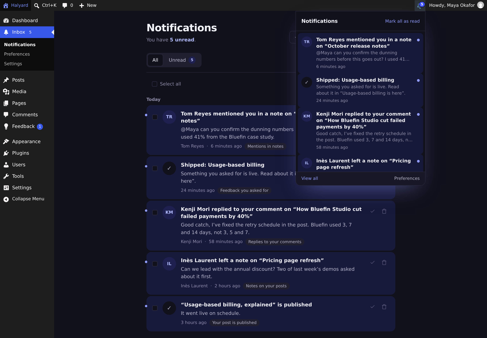
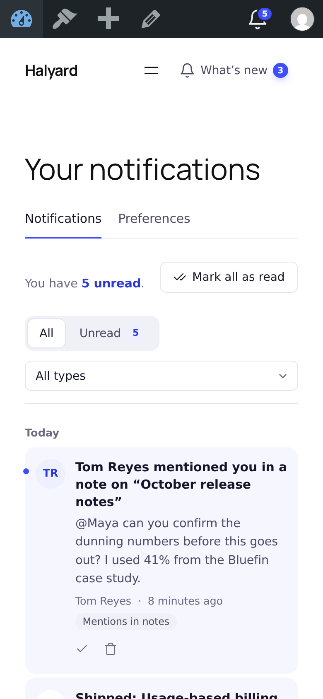
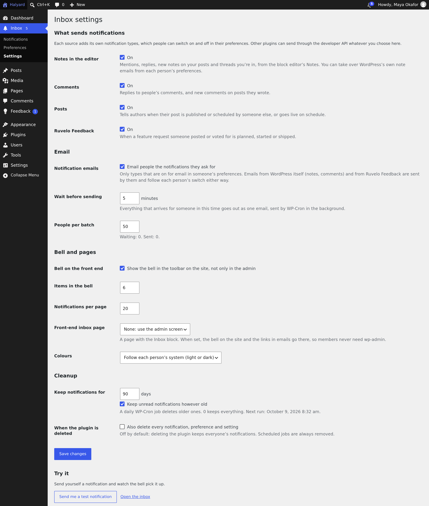

<p align="center">
  <a href="https://ruvelo.github.io/wp-inbox/"></a>
</p>

<p align="center">
  <a href="https://playground.wordpress.net/?blueprint-url=https://raw.githubusercontent.com/Ruvelo/wp-inbox/main/blueprint.json"><strong>Try it in Playground</strong></a> &nbsp;&nbsp;&nbsp;
  <a href="https://ruvelo.github.io/wp-inbox/"><strong>Website</strong></a> &nbsp;&nbsp;&nbsp;
  <a href="#for-developers"><strong>Developer guide</strong></a> &nbsp;&nbsp;&nbsp;
  <a href="CHANGELOG.md"><strong>Changelog</strong></a>
</p>

<p align="center">
  <a href="https://github.com/Ruvelo/wp-inbox/actions/workflows/tests.yml"></a>
  
  
  
  
  <a href="LICENSE"></a>
</p>

# Ruvelo Inbox

**The notification centre WordPress never shipped.** A bell with an unread count, an inbox and per-person preferences for everyone who signs in, plus a developer API other plugins send to. Core's own attempt (WP Notify) stalled in 2019, and WordPress 7.1's Notes create mentions and replies with nowhere central to collect them. Now they have somewhere to go.

```
wp plugin install https://github.com/Ruvelo/wp-inbox/releases/latest/download/ruvelo-inbox.zip --activate
```

That's all: the bell is in the toolbar, and notes, comments and posts start arriving. Or click around [Maya's inbox at Halyard in WordPress Playground](https://playground.wordpress.net/?blueprint-url=https://raw.githubusercontent.com/Ruvelo/wp-inbox/main/blueprint.json) first: it runs in your browser.

## A quick tour



**A bell in the toolbar,** in the admin and on the site. It shows how many notifications are unread and opens on the latest. Opening one marks it read and takes you straight to it. The count stays live over the WordPress Heartbeat the admin already runs: no polling of its own.



**An inbox for everything else.** All and Unread, grouped by day, filtered by type, with mark read, mark unread and delete on each item and in bulk. Every button is a plain form, so it all works without JavaScript.



**Preferences people set themselves.** One switch per kind of notification and channel. Emails wait a few minutes so a busy thread becomes one email, and each says why it came with a link to stop that kind. WordPress's own note and comment emails follow the same switches.

<table>
  <tr>
    <td width="50%"></td>
    <td width="50%"></td>
  </tr>
  <tr>
    <td><strong>On the site, too:</strong> the Inbox and Notification Bell blocks, for members who never see wp-admin.</td>
    <td><strong>Light and dark</strong>, following each person's system, or always one of them.</td>
  </tr>
  <tr>
    <td width="50%"></td>
    <td width="50%"></td>
  </tr>
  <tr>
    <td><strong>Mobile first</strong>, down to 360px.</td>
    <td><strong>Settings</strong>: what sends notifications, email batching, retention.</td>
  </tr>
</table>

## Features

- **A developer API** that other plugins send to with one line, with or without a dependency on this one: `Inbox::notify()` or the `ruvelo_inbox_notify` action. Types are registered with a label, description, group and default channels, and appear in everyone's preferences.
- **Built-in sources**, each a set of switchable types and each toggleable in Settings:
  - **Notes** (block editor, WordPress 6.9+): mentions (7.1), replies to your notes, notes on your posts, and replies in threads you're in.
  - **Comments**: replies to your comments (WordPress never sends these) and comments on your posts.
  - **Posts**: your scheduled post went live, or someone else published or scheduled your post.
  - **Ruvelo Feedback**: a request you posted or voted for was planned, started or shipped. Only when Ruvelo Feedback is active.
- **Per-person preferences**, per type and channel (inbox, email), respected by `notify()`, and used to switch WordPress's own note and comment emails (and Ruvelo Feedback's) on or off for each person, so nobody gets the same thing twice.
- **Email, batched**: queued, then sent by WP-Cron a few minutes later, one email per person with everything that arrived meanwhile. Plain text, with a signed unsubscribe link per type that asks before it acts, and RFC 8058 one-click headers where the mail transport keeps them intact.
- **The bell**: unread badge (99+), the latest items, mark all as read, View all and Preferences; an accessible dropdown (a real button, `aria-expanded`, Escape returns focus, new items announced through `wp.a11y.speak`). In the toolbar on the admin and the site, and as a block.
- **The inbox**: All and Unread, grouped by Today, Yesterday and dates in the site's timezone, a type filter, bulk actions and pages, as an admin screen and an Inbox block (with a Preferences tab) for the front end.
- **Live counts over the Heartbeat API**: the unread count every tick, the list only when something new arrived.
- **Cheap**: notifications live in their own table with `(user_id, read_at)`, `(user_id, created_at)` and `created_at` indexes; the unread count is one cached `COUNT`.
- **Retention**: a daily WP-Cron cleanup, 90 days by default, sparing unread ones unless you say otherwise.
- **Developer tools**: REST (`ruvelo-inbox/v1`), WP-CLI, Abilities API, actions and filters, overridable templates, settings in code, and test helpers for your plugin's tests.
- **Privacy**: personal data export and erasure, a privacy policy paragraph, a deleted user's notifications go with them, and no remote requests.
- **Safe by default**: nonces and ownership checks on every write, someone else's notification is a 404, `$wpdb->prepare()` everywhere, escaped output, only `http(s)` links, and the "open" link never redirects off-site.

## Our promises

- **No nags, no upsells, no "pro" version.** No admin notices, no review requests, no ads, no redirect on activation.
- **No tracking and no remote requests.** Nothing phones home; no fonts, scripts, avatars or banners are loaded from anywhere else. Avatars are initials.
- **Never used to promote anything.** The inbox carries what your site and its plugins send, never Ruvelo's own messages.
- **Updates only from WordPress.org and Composer**, through WordPress's own updater. Ruvelo will never sell this plugin, its WordPress.org account or its users.
- **A clean uninstall.** Scheduled jobs are always cleared. Notifications stay unless you tick "Also delete every notification, preference and setting".
- **Accessible**: aiming at WCAG 2.2 AA, working without JavaScript, respecting reduced motion and dark mode.

## Requirements

- WordPress 7.0 or later (tested up to 7.1; note mentions need 7.1)
- PHP 8.2 or later
- MySQL or MariaDB, or SQLite through the official integration plugin

## Getting started

**1. Install** by uploading [ruvelo-inbox.zip](https://github.com/Ruvelo/wp-inbox/releases/latest/download/ruvelo-inbox.zip) in Plugins → Add New → Upload Plugin, with WP-CLI as above, or with Composer (`composer require ruvelo/wp-inbox`, installed by `composer/installers` as a WordPress plugin).

**2. Look at the bell.** Notes, comments and posts start arriving straight away. Everyone chooses what they hear about in **Inbox → Preferences**.

**3. Adjust in Inbox → Settings** (administrators): which sources send notifications, whether the plugin sends its own emails and how long it waits, the bell on the front end, colours, cleanup, and a front-end inbox page.

**4. For a membership site**, add the **Inbox** block to a page (`[ruvelo_inbox]` on classic themes), choose it as the front-end inbox page, and add the **Notification Bell** block to your header (`[ruvelo_inbox_bell]`). The bell on the site and the links in emails then go there.

## Who can do what

| Capability | Default | |
|---|---|---|
| `read` | Everyone signed in | Their own inbox and preferences, in the admin, the blocks, REST and abilities |
| `ruvelo_send_notifications` | Administrators | Send to other people through REST and the abilities. Filter `ruvelo_inbox_sender_roles` |
| `ruvelo_manage_inbox` | Administrators | Change the settings. Filter `ruvelo_inbox_manager_roles` |

## Making it look like your site

Every colour, radius and font is a CSS variable on `.ruvelo-inbox` (pages) and `.ruvelo-inbox-bell` (the bell):

```css
.ruvelo-inbox, .ruvelo-inbox-bell { --ruvelo-inbox-accent: #0f766e; --ruvelo-inbox-accent-soft: #e6f4f1; --ruvelo-inbox-radius: 4px; --ruvelo-inbox-sans: Inter, sans-serif; }
```

To change the markup, copy a file from the plugin's `templates/` to `your-theme/ruvelo-inbox/` (for example `ruvelo-inbox/parts/item.php`), or use the `ruvelo_inbox_template` filter.

## For developers

### Sending

From any plugin, with no dependency (nothing happens if Ruvelo Inbox isn't active):

```php
do_action('ruvelo_inbox_notify', $user_ids, [
    'type' => 'invoice_paid',
    'title' => 'Invoice INV-2288 paid',
    'body' => 'Bluefin Studio paid €4,800.00 by SEPA transfer.',
    'url' => admin_url('admin.php?page=invoices&id=2288'),
    'icon' => '€',               // a short string or emoji; otherwise the actor's initials
    'actor' => get_current_user_id(), // a user ID, WP_User or a name
    'data' => ['invoice' => 2288],    // anything JSON can hold
]);
```

Register the type on `init`, so people can switch it in their preferences:

```php
add_action('init', function () {
    do_action('ruvelo_inbox_register_type', 'invoice_paid', [
        'label' => 'Invoice paid',
        'description' => 'When a customer pays one of your invoices.',
        'group' => 'Billing',
        'channels' => ['inbox', 'email'],     // the default
        'defaults' => ['email' => true],      // inbox defaults to on, email to off
        // 'required' => true,                // shown, always on
        // 'sends_email' => false,            // you send your own email; the switch is just a preference
    ]);
});
```

`$user_ids` can be one ID, a `WP_User` or an array of either. Each person gets the notification on the channels they want for that type. Unregistered types work too: inbox only, labelled after their key.

### PHP API

```php
use Ruvelo\WP\Inbox\Inbox;

Inbox::notify($users, $message);          // list of new inbox row IDs
Inbox::registerType('invoice_paid', [...]);
Inbox::unreadCount($user_id);             // one cached COUNT
Inbox::latest($user_id, 6);
Inbox::query($user_id, ['status' => 'unread', 'type' => 'invoice_paid', 'page' => 1, 'per_page' => 20]);
Inbox::find($id, $user_id);               // null if it isn't theirs
Inbox::markRead($id, $user_id);
Inbox::markUnread($id, $user_id);
Inbox::markAllRead($user_id);
Inbox::delete($id, $user_id);
Inbox::wants($user_id, 'invoice_paid', 'email');
Inbox::preferences($user_id);             // [type => [channel => bool]], defaults filled in
Inbox::updatePreferences($user_id, ['invoice_paid' => ['email' => false]]); // true or WP_Error
```

`Inbox` is the one write path: the screens, REST, WP-CLI, abilities and sources all use it. It doesn't check capabilities; callers do.

### Testing your plugin

```php
use Ruvelo\WP\Inbox\Testing\Fake;
use Ruvelo\WP\Inbox\Testing\Factory;

$fake = Fake::start();                    // records instead of sending
my_plugin_marks_the_invoice_paid();
$this->assertCount(1, $fake->sentTo($user_id, 'invoice_paid'));
$fake->stop();

Factory::create($user_id, ['type' => 'invoice_paid', 'read' => true]);   // straight into the inbox
Factory::createMany($user_id, 30);
```

### Data

| What | Where |
|---|---|
| Notifications | Table `{prefix}ruvelo_inbox_notifications`: `user_id`, `type`, `title`, `body`, `url`, `icon`, `actor_id`, `actor_name`, `data` (JSON), `read_at`, `created_at`; indexes `(user_id, read_at)`, `(user_id, created_at)`, `created_at` |
| Email queue | Table `{prefix}ruvelo_inbox_emails`, one row per notification, worked through by WP-Cron (`ruvelo_inbox_send_emails`) |
| Preferences | User option `ruvelo_inbox_preferences` (per site): only explicit choices |
| Settings | Option `ruvelo_inbox_settings` (filter `ruvelo_inbox_settings` to define them in code) |
| Cleanup | Daily WP-Cron event `ruvelo_inbox_prune` |

### Actions

| Action | Arguments | When |
|---|---|---|
| `ruvelo_inbox_notify` | `$users, $message` | Fire it to send (the dependency-free API) |
| `ruvelo_inbox_register_type` | `$name, $args` | Fire it to register a type |
| `ruvelo_inbox_register_types` | | When to register types (on `init`, after the built-in ones) |
| `ruvelo_inbox_type_registered` | `$name, $args` | A type was registered |
| `ruvelo_inbox_notification_created` | `$id, $user_id, $message` | A notification landed in someone's inbox |
| `ruvelo_inbox_notified` | `$ids, $user_ids, $message` | A notification went to everyone |
| `ruvelo_inbox_email_queued` | `$id, $user_id, $message` | An email is waiting for WP-Cron |
| `ruvelo_inbox_email_sent` | `$user, $items, $status` | An email went to `wp_mail()` (`sent` or `failed`) |
| `ruvelo_inbox_read`, `ruvelo_inbox_unread` | `$id, $user_id` | Marked read or unread |
| `ruvelo_inbox_read_all` | `$user_id, $count` | "Mark all as read" |
| `ruvelo_inbox_deleted` | `$id, $user_id` | A notification was deleted |
| `ruvelo_inbox_preferences_updated` | `$user_id, $saved` | Someone's preferences changed (also on unsubscribe) |

### Filters

| Filter | Default | |
|---|---|---|
| `ruvelo_inbox_message` | | Change a notification before it's sent; an empty title cancels it |
| `ruvelo_inbox_recipients` | | Change who gets it |
| `ruvelo_inbox_pre_notify` | `null` | Return an array of IDs to skip storing and emailing (the test fake) |
| `ruvelo_inbox_notification_channels` | Their preferences | `($channels, $user_id, $message)` per person |
| `ruvelo_inbox_wants` | Their preferences | `($wants, $user_id, $type, $channel)` |
| `ruvelo_inbox_type_args` | | `($args, $name)` as a type is registered |
| `ruvelo_inbox_email` | The composed email | `($email, $user, $items)`; return false to skip |
| `ruvelo_inbox_heartbeat` | | What the Heartbeat sends the bell |
| `ruvelo_inbox_show_bell` | `true` | Show the toolbar bell to this person |
| `ruvelo_inbox_post_types` | Public post types | Whose authors hear about publishing |
| `ruvelo_inbox_url`, `ruvelo_inbox_preferences_url` | Admin screens, or the front-end page | Where "View all", "Preferences" and emails link |
| `ruvelo_inbox_template` | | `($file, $template)`: use another template file |
| `ruvelo_inbox_settings` | Saved settings | Define settings in code |
| `ruvelo_inbox_manager_roles`, `ruvelo_inbox_sender_roles` | `administrator` | Roles given the capabilities on activation |
| `ruvelo_inbox_uninstall_delete_data` | The setting | Decide in code whether uninstalling deletes everything |

### REST API

Namespace `ruvelo-inbox/v1`. Every route needs a signed-in user (cookie authentication with the `wp_rest` nonce, or application passwords) and only touches that user's own notifications. Paths are relative to `/wp-json/ruvelo-inbox/v1`.

| Request | Does |
|---|---|
| `GET /notifications?status=all\|unread&type=&page=&per_page=` | List, newest first. `meta.unread`, `meta.total`, `meta.types`; `X-WP-Total` and `X-WP-TotalPages` headers |
| `GET /notifications/count` | `{"unread": 3, "latest": 812}`: cheap enough to poll |
| `GET /notifications/{id}` | One notification |
| `POST /notifications/{id}/read` | Mark read; returns it with the new `unread` count |
| `POST /notifications/{id}/unread` | Mark unread |
| `POST /notifications/read-all` | `{"marked": 3, "unread": 0}`; `?type=` for one type |
| `DELETE /notifications/{id}` | Delete |
| `GET /preferences` | Channel labels, and every type with its label, description, group, `required` and `channels: {inbox: true, email: false}` |
| `PUT /preferences` | `{"preferences": {"invoice_paid": {"email": false}}}`; only the pairs sent change. `422` for unknown types or channels, or for turning off a required type |
| `GET /types` | Registered types |
| `POST /notifications` | Send: `{users: [ids], title, body?, url?, type?, icon?}`. Needs `ruvelo_send_notifications` |

A notification looks like this:

```json
{
  "id": 812, "type": "note_mention", "type_label": "Mentions in notes",
  "title": "Tom Reyes mentioned you in a note on “October release notes”",
  "body": "@Maya can you confirm the dunning numbers before this goes out?",
  "url": "https://halyard.test/wp-admin/post.php?post=60&action=edit", "icon": "",
  "actor": {"id": 2, "name": "Tom Reyes"}, "avatar": "TR", "read": false, "read_at": null,
  "created_at": "2026-10-09T07:11:43+00:00", "time_ago": "6 minutes ago", "day": "Today",
  "data": {"post_id": 60, "comment_id": 31}, "open_url": "https://halyard.test/wp-admin/admin.php?page=ruvelo-inbox&ruvelo_inbox_open=812&_wpnonce=…"
}
```

Errors: `401` for guests, `403` when not allowed, `404` for someone else's notification, `422` for invalid preferences.

### WP-CLI

| Command | |
|---|---|
| `wp ruvelo-inbox send <user>... --title=<title> [--body=] [--url=] [--type=] [--icon=] [--actor=] [--porcelain]` | Send to users (ID, login or email) |
| `wp ruvelo-inbox send --role=<role> --title=<title>` | Send to everyone with a role (`all` for everyone) |
| `wp ruvelo-inbox list <user> [--unread] [--type=] [--per-page=] [--format=]` | Someone's notifications |
| `wp ruvelo-inbox prune [--days=] [--include-unread] [--dry-run]` | Delete old notifications now |
| `wp ruvelo-inbox types [--format=]` | Registered types |
| `wp ruvelo-inbox emails status` / `run [--now]` | See or send waiting emails |
| `wp ruvelo-inbox demo --yes` | Seed Halyard's demo (for trying it out) |

### Abilities (AI agents)

Registered with the WordPress Abilities API in the `ruvelo-inbox` category, with both `meta.public` (7.1) and `meta.show_in_rest` (7.0) so they're in REST on both, and available to the MCP adapter when it's installed. Agents act as the signed-in person.

| Ability | Permission |
|---|---|
| `ruvelo-inbox/list-notifications` | Signed in: their own (read-only) |
| `ruvelo-inbox/get-unread-count` | Signed in: their own (read-only) |
| `ruvelo-inbox/mark-read` | Signed in: their own |
| `ruvelo-inbox/send-notification` | `ruvelo_send_notifications` |

### Blocks and shortcodes

| Block | Shortcode | |
|---|---|---|
| `ruvelo/inbox` | `[ruvelo_inbox preferences="yes" heading="yes" per_page="20"]` | The inbox, with a Preferences tab |
| `ruvelo/inbox-bell` | `[ruvelo_inbox_bell label="Updates"]` | A bell for your header; nothing for guests |

### How the sources work

- **Notes** are comments of type `note`. A new note tells, once each and by the most specific reason: people mentioned (`<span class="wp-note-mention user-N">`, WordPress 7.1), the author of the note replied to, the post's author, and everyone else who wrote in the thread. Only people who can edit the note (who can see it in the editor) are told. When the source is on, core's `wp_notify_note_mentions()` is swapped for a copy that asks each person's "Mentions in notes" email switch before calling core's own `wp_send_note_notification()`, and the `notify_post_author` filter asks the post author's "Notes on your posts" switch. WordPress doesn't store thread followers, so writing in a thread is what follows it.
- **Comments**: approved comments only, each once (also when approved later). Replies go to the parent comment's author if they have an account; the post author gets "comments on your posts", and core's `comments_notify` email follows their switch.
- **Posts**: `transition_post_status` to `publish` (when someone else did it, or a scheduled post went live) and to `future` (when someone else scheduled it).
- **Ruvelo Feedback**: listens to `ruvelo_feedback_notification` (`$recipient, $message`) for signed-in recipients, and answers `ruvelo_feedback_send_email` from their switch. Guests who voted by email keep getting Ruvelo Feedback's email.

### A note on DataViews

WordPress 7.0 rebuilt some screens on DataViews, and 7.1 added `GET /wp/v2/view-config`. That configuration is read by core's own screens, and the DataViews package isn't exposed to plugins as a script handle, so using it would mean bundling React with a build step. The inbox is a server-rendered screen instead: it works without JavaScript, and the same templates power the front-end block.

## Contributing

Pull requests are welcome. Clone, `composer install`, `bin/dev-site.sh` for a local SQLite site with the demo, then `composer check` runs code style (Pint), the WordPress sniffs (PHPCS), static analysis (PHPStan level 8) and the tests, exactly as CI does. See [CONTRIBUTING.md](CONTRIBUTING.md).

## Credits

Built by [François Bultez](https://github.com/francoisbultez) at [Valtry](https://valtry.co.uk/?utm_source=ruvelo&utm_medium=github&utm_campaign=wp-inbox), the website security scanner, and everyone who [contributes](https://github.com/Ruvelo/wp-inbox/graphs/contributors).

## License

GPL-2.0-or-later. See [LICENSE](LICENSE).
